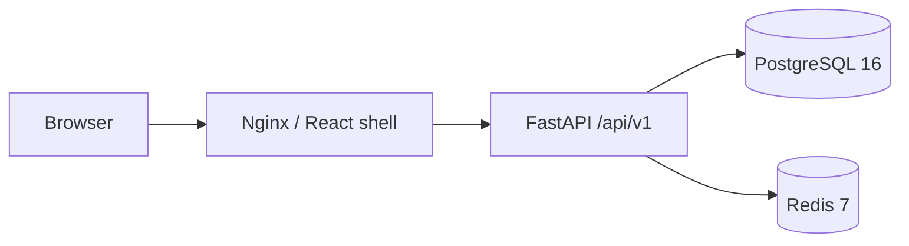

# Architecture

Phase 1 implements health probes and the deployment foundation. Phase 2 adds the [56-table PostgreSQL schema and ER diagrams](../database/README.md), frozen Alembic revisions, forced tenant RLS, separate service database capabilities and audit triggers. Compose runs bootstrap and migrations before the API with an unprivileged runtime login. Readiness executes SELECT 1 and Redis PING with timeouts, returning 503 on failure. Liveness is independent of dependencies. No business routes exist. API errors use code, message, details and server-generated request_id; validation errors deliberately exclude input values. Logs must never include biometric payloads, secrets, or bearer tokens.

Later phases introduce thin routes, central authorization policies, tenant-filtered repositories, transaction-owning services, and PostgreSQL tenant enforcement. The default is deny. Business services never import ML libraries. A separate biometric worker will own detect/quality/liveness/embed/compare; consent and calibrated one-to-one verification must precede any automated attendance mark. Uncertain verification requires review. An audited manual route is mandatory.

An outbox will couple business transactions to reliable notifications. Redis is coordination/cache infrastructure, never the attendance source of truth. Android will consume the same authenticated API and must never queue offline biometric marks.

The operational health routes are intentionally unauthenticated and expose no tenant or credential data. They are the only application routes in this phase (alongside OpenAPI documentation). OpenAPI visibility must be revisited for production in the security phase.
