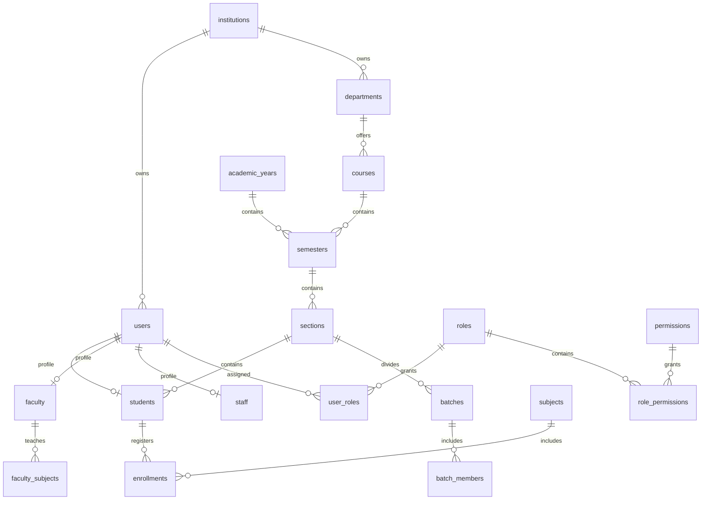
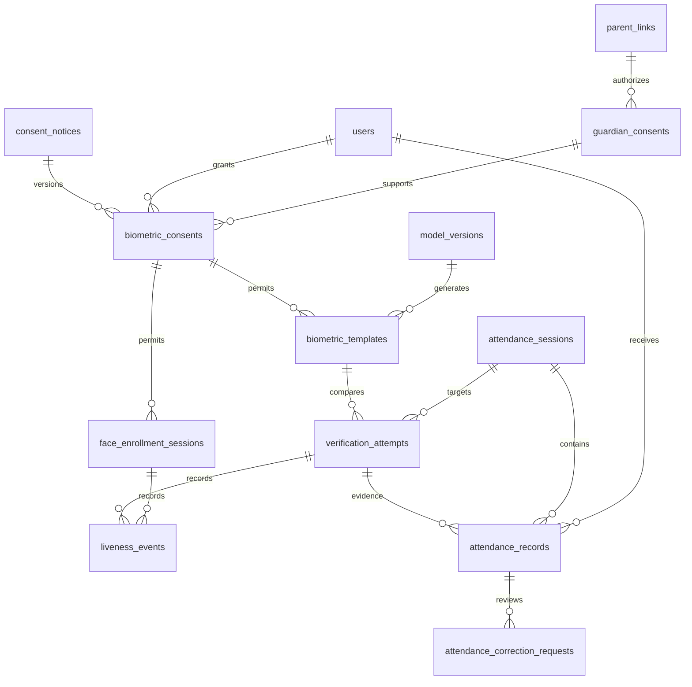
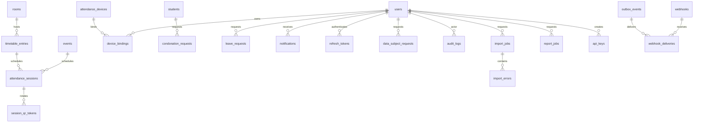

# Database and migrations

Phase 2 defines **56 PostgreSQL tables**: all specified core/additional tables plus consent_notices, batches, batch_members and events. It implements storage boundaries, not the later HTTP/business workflows.

The [full column/constraint/index dictionary](schema.md) is generated from current metadata. [Full ER source](schema.mmd) includes all tables and foreign-key edges. The compact diagrams below group the main relationships; every non-catalogue relationship also includes institution_id even when omitted from labels.







Tenant-scoped holidays, settings, retention policies, feature flags, anomalies and idempotency keys appear in the full diagram/dictionary.

## Run migrations on Windows

From the repository root, with Docker Desktop's Linux engine running:

```powershell
docker compose -f infrastructure/docker-compose.yml up --build --wait
docker compose -f infrastructure/docker-compose.yml run --rm migrate alembic current
```

Compose runs role bootstrap, then the one-shot Alembic migration service, then the API with an unprivileged runtime login. PostgreSQL data persists. The bootstrap role SQL is local infrastructure setup, not manual application-schema DDL, and is idempotent for existing dev volumes. Never grant the runtime login membership in the biometric group or use the migration account in the API.

For an existing native PostgreSQL 16+ database, first provision the non-login groups and a separate runtime login with institutional secret management. Set AIFAMS_MIGRATION_DATABASE_URL for the migration principal and AIFAMS_DATABASE_URL for the runtime principal in backend/.env. Use the asyncpg URL scheme. Migrations do not create the database itself.

```powershell
Set-Location backend
.\.venv\Scripts\python.exe -m alembic upgrade head
.\.venv\Scripts\python.exe -m alembic current
.\.venv\Scripts\python.exe -m alembic check
```

Expected: logs show Running upgrade for 0001 (schema) and 0002 (security); current prints 0002 (head); check prints No new upgrade operations detected. An error rolls back the upgrade. Connection URLs are read from settings, not written into alembic.ini. Plain SQL review is available with `python -m alembic upgrade head --sql`; this does not execute or validate a migration against a real server.

In a **disposable database only**, `python -m alembic downgrade base` removes all 56 application tables/functions. Re-upgrade with upgrade head. Shared service groups remain. Downgrading a live institutional database loses data; use reviewed forward migrations and backups in production.

## Run real database tests

Create a new empty database whose name begins with aifams_test. The principal must own it and be able to create the two service groups on first use (or use pre-provisioned groups). Set AIFAMS_TEST_DATABASE_URL in your PowerShell session, then:

```powershell
.\scripts\test.ps1 -RequireDatabase
```

The suite refuses a differently named or non-empty database. It migrates head → base → head, checks metadata drift, and tests real PostgreSQL constraints, RLS, privileges and triggers. It leaves fixtures in that disposable database for failure diagnosis; create a new empty database for another run. Database tests are skipped explicitly when the environment variable is absent; a skipped run does not satisfy Phase 2 acceptance. CI provides a fresh PostgreSQL 16 service and always enables them.

Regenerate the dictionary/ER source with `backend/.venv/Scripts/python.exe scripts/export_schema_docs.py`. Create future revisions with `python -m alembic revision --autogenerate -m "describe change"`, review them, and add explicit policy/trigger migrations and tests. Never rewrite an applied revision or rerun the initial-revision authoring script to implement future changes.
